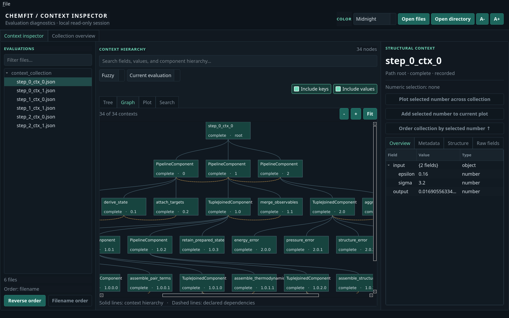

<p align="center">
  
</p>

# ChemFit Dashboard

A desktop application for exploring, visualizing, and extracting evaluation data from [ChemFit](https://github.com/MSallermann/chemfit).

ChemFit records inputs, outputs, metadata, intermediate results, and errors in structured evaluation contexts. ChemFit Dashboard makes this information accessible without having to inspect JSON files manually.

Built with Python and PySide6, the dashboard works directly with legacy ChemFit
context summaries and the versioned `chemfit.evaluate_context` record format.
It runs locally, does not modify the original data, and can be used independently
of ChemFit and the simulation software that produced the results.



## Features

- **Explore evaluations:** Browse individual evaluations or entire collections, including nested components, inputs, outputs, metadata, and errors.
- **Visualize data flow:** Follow declared computational data flow through structural components, with interactive navigation into nested graphs.
- **Search:** Find components, fields, and values within an evaluation or across an entire collection, using fuzzy matching, exact text, or regular expressions.
- **Plot results:** Plot numerical quantities across evaluations, compare multiple series, and export plots and data.
- **Investigate failures:** Identify failed evaluations and navigate to the components responsible.
- **Extract data:** Collect arbitrary values from evaluation contexts and export them as CSV or JSONL for further analysis.

The application also supports several color themes, classic and lightweight visual
styles, adjustable density and font sizes, keyboard navigation, and background
processing of large collections. The expandable status footer shows concurrent
operations and determinate progress for collection work, including large data
exports.

## Installation

ChemFit Dashboard requires Python 3.10 or newer.

Clone the repository:

```bash
git clone https://github.com/MSallermann/chemfit_dashboard.git
cd chemfit_dashboard
```

Install the dashboard with its GUI dependencies:

```bash
python -m pip install -e ".[gui]"
```

ChemFit itself is not required to inspect previously saved evaluation contexts.

For headless extraction only, Qt is not required:

```bash
python -m pip install -e .
```

## Getting started

Launch the dashboard with:

```bash
chemfit-dashboard
```

Open an evaluation file or a directory containing serialized contexts through the application, or supply the path directly:

```bash
chemfit-dashboard path/to/context.json
chemfit-dashboard path/to/trajectory.jsonl
chemfit-dashboard path/to/results/
```

Preload a saved extraction configuration when opening the GUI with
`-c`/`--extraction-config`:

```bash
chemfit-dashboard path/to/results/ \
  --extraction-config extraction.json
```

The configuration is validated before the window opens. Its fields, column
names, flattening/array options, and identifier settings are installed in
the **Data Extraction** tab; once the collection finishes loading, its preview
is built normally.

Multiple files and directories can be provided together. A JSON file contributes
one evaluation; a JSONL trajectory contributes one evaluation per nonblank line.
A directory contributes its immediate `.json` and `.jsonl` files; subdirectories
are never opened automatically. Use **File → Add files to collection** to
actively combine additional results with the open collection.

The repository also includes example evaluation data written with ChemFit's
versioned `FitContext.to_record()` format:

```bash
# Open a single evaluation
chemfit-dashboard examples/step_0_ctx_0.json

# Open a collection
chemfit-dashboard examples/context_collection/
```

## Exploring evaluation data

### Evaluation hierarchy and inspector

The **Evaluations** sidebar lists the loaded contexts. Select an evaluation to
inspect its component hierarchy. The selected file's full path is shown below
the list, where it can be selected or copied, and **Open folder** reveals its
containing directory in the system file explorer.

Selecting a component displays its recorded inputs, outputs, metadata, and other information in the inspector. Nested dictionaries and arrays can be expanded to explore individual values.

Components can be identified using a configurable metadata field, making it easier to navigate evaluations with descriptive component names.

When working with a collection, evaluations can also be ordered by the value of a selected numerical field.

Major views are directly accessible with **Ctrl+1** through **Ctrl+6**:
Context Hierarchy, Data Flow, Context Search, Data Extraction, Collection Plot,
and Collection Overview respectively. **Ctrl+D** also opens Data Extraction.
Press **F1** in the dashboard for the complete shortcut list.

### Data Flow

The **Data Flow** tab visualizes the declared flow of information through a structural component.

It shows how the component's input feeds its immediate children, how those children depend on one another, and which results contribute to the output.

Nested structural components can be opened by double-clicking them. Breadcrumb navigation makes it possible to move between different levels of the hierarchy.

Selecting a component in Data Flow also selects it in the hierarchy and inspector.

The graph can be zoomed, fitted to the view, or opened in a larger separate window.

To keep rendering responsive, individual graph levels containing more than 5,000 components are not rendered. The component hierarchy and recorded evaluation data remain accessible.

### Search

Search for component names, field names, metadata, or recorded values.

Search supports three modes:

- **Fuzzy:** Find approximate matches, including incomplete names.
- **Exact:** Find matching text.
- **Regex:** Search using regular expressions.

Search can be restricted to the current evaluation or applied to the entire loaded collection. Results can be selected to navigate directly to the corresponding context or value.

Whole-collection search uses a persistent pool of spawned worker processes,
defaulting to two. Large local extraction exports share this pool. Its size is
adjustable under **Settings > Workers**, separately from the shared background
thread pool used by loading, analysis, plotting, smaller exports, and graph
layout.
Workers load and search bounded batches with the same in-memory fuzzy, exact, and
regular-expression implementation used for one evaluation, keeping CPU-intensive
JSON parsing and ranking away from the GUI thread. Worker-local document and search
index caches are deliberately bounded; no database or persistent index is created.
Only one bounded chunk per configured process is submitted at once. Changing the query cancels chunks
that have not started and discards results from superseded generations; a chunk
already running finishes because Python futures cannot interrupt process work. The
pool is reused across searches and shut down when the dashboard closes. Each worker
adds a Python interpreter and a bounded worker-local cache set, which is
the main memory cost of keeping collection search away from the GUI's GIL.

### Collection overview

The **Collection Overview** provides a summary of the loaded evaluations, including:

- Successful, failed, and partially completed evaluations.
- Numerical fields and their summary statistics.
- Frequently skipped or missing components.
- Recorded failures and exceptions.

Failure entries can be used to navigate to the relevant evaluation and component.

## Plotting numerical results

Numerical values can be plotted across an entire collection.

To create a plot, select a number in the inspector and click **Plot**. The dashboard extracts the corresponding value from each evaluation and displays it against the evaluation index.

Use **+ Series** to add additional quantities to the same plot.

The plotting interface supports:

- Multiple series with distinct colors.
- Showing, hiding, and removing individual series.
- Independent normalization of series to the 0–1 range.
- Logarithmic Y-axis scaling.
- Interactive zooming and coordinate inspection.
- Line, binned-histogram, and descriptive-statistics display modes.
- Selection of plotted points to open the corresponding evaluation.
- A detachable, full-size plot window.

Plots can be exported as PNG or SVG images.

Plot selectors reuse the selected component's integer node path and field path
across the collection. Evaluations where that path is missing or not numeric are
counted as missing points. Use Data Extraction when the underlying values or
explicit missing-value statuses are needed; CSV leaves unavailable cells empty,
while JSONL retains the exact statuses.

## Data extraction

Data extraction allows arbitrary information to be collected from multiple evaluations for further analysis.

Unlike plotting, it is not restricted to numbers. You can extract strings, dictionaries, arrays, metadata, individual fields, or complete components.

### Selecting data

Suppose you have a collection of optimization evaluations and want to analyze the optimized parameters and resulting objective values.

1. Select an evaluation and locate a parameter in the inspector.
2. Click **+ Field** to add it to the extraction.
3. Select the objective value and add that as another field.
4. Open the **Data Extraction** tab.
5. Rename or reorder the columns if desired.
6. Export the resulting table as CSV or JSONL.

By default, each evaluation contributes one row and each selected value contributes one column.

The extraction follows the selected fields across the entire collection, rather than requiring you to select the same values separately in every evaluation.

When the selected component has siblings, the Inspector also offers **+ Sibling
Fields** and **+ Sibling Components**. These create a wildcard selector for all
children of the same parent. For example, selecting component `/2/7` creates
`/2/*`; the exporter discovers every matching concrete path in the collection
and gives each match its own path-qualified column, such as
`output.energy@/2/0`, `output.energy@/2/1`, and so on. If a particular
evaluation lacks one of those
children, that cell has the `missing_component` status.

### Working with structured values

The extraction interface also supports nested data:

- **+ Component** adds an entire component, including its fields and metadata.
- **Include node paths** controls whether every output name includes its
  concrete component path. Automatic names use the complete JSON and node path:
  `output.force@/2/0` by default or `output.force` with node paths disabled. An
  explicit rename uses `force@/2/0` or simply `force`, respectively.
- **Flatten objects** converts nested dictionary values into separate columns.
- **Expand arrays** is configured independently for every selected field. When
  enabled, its **Levels** control chooses how many dimensions become columns;
  disabling it keeps the array packed. For a positions array shaped `[N, 3]`,
  choose two levels for scalar coordinate columns while retaining one row per
  evaluation.
- Right-click a preview column header to copy, sort, rename, or remove that
  column. Select several fields or preview columns to remove them together;
  **Delete** removes selected fields and **Backspace** removes selected preview
  columns. In the preview, click a column header to select and highlight it,
  then press **S** to sort or reverse the collection by that column or **R** to
  rename it.

For example, extracting a dictionary containing `energy` and `forces` can
produce separate columns for these values when object flattening is enabled.

The preview displays up to 200 evaluations. Exports process the entire collection.

### Export execution and progress

GUI exports stream results instead of building the complete table in memory.
For a local JSON collection containing 200 or more evaluations, the dashboard
runs the export in a spawned worker process. Smaller collections and sources
that cannot safely be reconstructed in another process use a background thread.
Both paths keep file parsing and serialization away from the GUI thread.

The status footer shows export progress. Wildcard selectors require a discovery
pass to find the union of matching component paths. CSV exports that flatten
objects or expand arrays use another discovery pass for their nested output
columns; the final pass writes the rows. The progress total covers every pass.

There is no fixed limit on flattened or expanded CSV columns. Every path
discovered in the collection is included unless it is explicitly excluded in
the field configuration. Very wide exports can require substantial memory,
storage, and processing time, and spreadsheet applications may impose their own
column limits.

GUI exports are published atomically. Data is first written to a temporary file
beside the selected destination, and the destination is replaced only after the
complete export succeeds. A failure or cancellation removes the temporary file
and leaves an existing destination untouched.

### Headless extraction

Extraction configurations saved from the GUI can also be run without Qt using the
`chemfit-extract` command:

```bash
chemfit-extract path/to/results/ \
  --config extraction.json \
  --format csv \
  --output values.csv
```

Input paths may be individual context JSON files, ChemFit JSONL trajectories, or
directories. Directories contribute their immediate JSON and JSONL files only.
Multiple input paths can be supplied. JSONL output is supported in the same way:

```bash
chemfit-extract run-a/ run-b/ -c extraction.json -f jsonl -o values.jsonl
```

The format can be omitted when the output filename ends in `.csv` or `.jsonl`.
Existing output files are protected by default; pass `--force` to replace one.

### Export formats

**CSV** produces a tabular representation suitable for Pandas, spreadsheets,
and other analysis tools. Nested dictionaries and arrays are stored as JSON
strings unless object flattening or array-level column expansion is requested.
Every evaluation still contributes exactly one CSV row.

**JSONL** preserves nested JSON objects and arrays. Each line represents an extracted row and includes the selected values and their extraction statuses.

CSV writes only available values and leaves every unavailable cell empty. JSONL
distinguishes missing fields, skipped or unexecuted components, unreadable
evaluations, explicit nulls, and recorded exceptions through its `status` object.

Exports are processed incrementally to avoid retaining the complete extracted dataset in memory.
The process/thread selection, activity progress, and atomic publication described
above apply to exports started from the GUI. The headless command and Python API
reuse the same streaming format implementation without requiring Qt.

### Saving extraction configurations

If you regularly analyze the same quantities, you can save your field selections using **Save configuration**.

For example, after selecting a parameter and an objective value, saving the configuration records which fields to extract, their column names, and any flattening or expansion options.

The next time you open another collection, use **Load configuration** to restore those selections.

A configuration is a small JSON file describing **what to extract**, not a copy of the extracted results.

Component selections store a `NodePathSelection`: integer segments select exact
components and `"*"` segments select every immediate child at that hierarchy
level. A saved configuration can therefore target either a stable concrete path
or a varying set of sibling components. An evaluation where a concrete path
from the collection-wide wildcard union does not exist receives the explicit
`missing_component` status.

## Using the extraction API from Python

The extraction functionality can also be used directly from Python without opening the dashboard.

For example, the following script extracts the root `output` value from each
evaluation in the included example collection:

<!-- extraction-api-example:start -->
```python
from chemfit_dashboard import (
    ExtractionConfig,
    FieldSelector,
    OutputDescriptor,
    export_csv,
    extract_fields,
)
from chemfit_dashboard.source import JsonFileSource

# Find the evaluation files
source = JsonFileSource()
records = source.discover(["examples/context_collection/"])

# Select a value. The default output name is the selector's complete path.
loss_selector = FieldSelector(node_path=(), value_path=("output",))
loss_output = OutputDescriptor()
config = ExtractionConfig(fields=((loss_selector, loss_output),))

# Inspect the values
for row in extract_fields(source, records, (loss_selector,)):
    result = row.values[0]
    print(row.filename, result.value, result.status.value)

# Export all evaluations
export_csv("losses.csv", source, records, config)
```
<!-- extraction-api-example:end -->

The `FieldSelector` identifies the value to extract:

- `node_path=()` selects the root evaluation context. Nested components use
  integer paths such as `(0, 2)`. A `"*"` segment matches every immediate child,
  so `(0, "*")` selects all children below component `0`.
- `value_path=("output",)` traverses the selected context's raw JSON value.
  String dictionary keys and integer list indexes can be combined in this tuple.

`OutputDescriptor` controls only the exported representation:

- `column=None` (the default) uses the complete selector path, such as
  `output.force@/2/0`. `column="force"` explicitly renames it to
  `force@/2/0` while node paths are enabled.
- `flatten=True` expands nested dictionaries into CSV columns.
- `array_expansion_depth=N` expands up to `N` list dimensions into CSV columns.
- `excluded_paths` omits selected flattened paths.
- `flattened_column_names` renames individual flattened paths.

`ExtractionConfig.fields` pairs each selector with one output descriptor. Its
`include_identifiers` flag controls the additional CSV identity columns, while
`include_node_paths` controls path qualification. Missing or unavailable CSV
values are empty cells; JSONL retains a separate `status` object with the exact
reason. Configuration files written by `save_config()` use the current version
6 schema and can be loaded by the GUI, `chemfit-extract`, or `load_config()`.
Existing version 3, 4, and 5 configurations remain supported.

To extract additional quantities, append more `(FieldSelector,
OutputDescriptor)` pairs to `ExtractionConfig.fields`. Exact selectors can be
passed directly to `extract_fields()`. For wildcard selectors, call
`resolve_fields(source, records, config.fields, ...)` first and extract the
concrete selectors from the returned fields. CSV and JSONL export do this
automatically and apply the configuration's naming options.

The `extract_fields()` function returns an iterator, allowing results to be
processed without loading the complete extracted collection into memory. Each
`ExtractionValue` includes an `ExtractionStatus` such as `available`,
`explicit_null`, `missing_component`, `missing_field`, `skipped_component`, or
`unreadable_evaluation`.

The extraction API does not require Pandas or NumPy.

## Development

Read [ARCHITECTURE.md](ARCHITECTURE.md) for the runtime data flow, module map,
state and cache ownership, background-task rules, and pointers for common changes.

Install the test dependencies:

```bash
python -m pip install -e ".[test]"
```

Run the tests:

```bash
pytest -q
```

Lint and type-check the source:

```bash
ruff check src tests benchmark
pyright
```

### Performance benchmarks

The repository includes benchmarks for collection discovery, context parsing, indexing, search, extraction, export, plotting, and Data Flow layout and rendering.

Run the standard benchmark with:

```bash
PYTHONPATH=src python benchmark/benchmark.py --profile standard
```

The generated workload uses the versioned `to_record` shape by default. Use
`--record-format legacy` to compare it with legacy context-summary files.
To run the complete workload against a ChemFit trajectory instead of individual
JSON files, use:

```bash
PYTHONPATH=src python benchmark/benchmark.py --profile standard --input-format jsonl
```

By default, the generated collection is removed after the benchmark. To retain
it for interactive use, provide an empty or nonexistent directory:

```bash
PYTHONPATH=src python benchmark/benchmark.py --profile standard \
  --collection-directory ./benchmark_collection
chemfit-dashboard ./benchmark_collection
```

With `--input-format jsonl`, open
`./benchmark_collection/trajectory.jsonl` instead.

A larger stress profile tests scaling to 50,000 evaluation files, millions of recorded component contexts, wide exports, and a 25,000-node graph layout:

```bash
PYTHONPATH=src python benchmark/benchmark.py --profile stress
```

The stress profile can require substantial memory, CPU time, and temporary disk space. Its largest graph is used for layout testing; the graphical rendering limit is checked separately.

For a smaller stress test:

```bash
PYTHONPATH=src python benchmark/benchmark.py --profile stress \
  --evaluations 5000 --graph-nodes 5000 \
  --components-per-evaluation 20 --root-fields 40
```

See [BENCHMARKS.md](BENCHMARKS.md) for methodology, recorded results, and known performance limitations.

## Related projects

- [ChemFit](https://github.com/MSallermann/chemfit) — A Python framework for automated high-dimensional model parameter optimization.
- [pydictnest](https://github.com/MSallermann/pydictnest) — Utilities for working with nested Python data structures.

## Issues and feedback

Bug reports, feature requests, and suggestions are welcome through the [GitHub issue tracker](https://github.com/MSallermann/chemfit_dashboard/issues).
