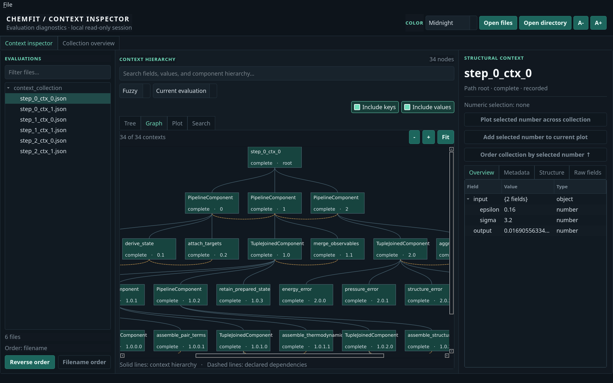

<p align="center">
  
</p>

# ChemFit Dashboard

A desktop application for exploring, visualizing, and extracting evaluation data from [ChemFit](https://github.com/MSallermann/chemfit).

ChemFit records inputs, outputs, metadata, intermediate results, and errors in structured evaluation contexts. ChemFit Dashboard makes this information accessible without having to inspect JSON files manually.

Built with Python and PySide6, the dashboard works directly with serialized evaluation contexts from ChemFit 4.0.0. It runs locally, does not modify the original data, and can be used independently of ChemFit and the simulation software that produced the results.



## Features

- **Explore evaluations:** Browse individual evaluations or entire collections, including nested components, inputs, outputs, metadata, and errors.
- **Visualize data flow:** Follow declared computational data flow through structural components, with interactive navigation into nested graphs.
- **Search:** Find components, fields, and values within an evaluation or across an entire collection, using fuzzy matching, exact text, or regular expressions.
- **Plot results:** Plot numerical quantities across evaluations, compare multiple series, and export plots and data.
- **Investigate failures:** Identify failed evaluations and navigate to the components responsible.
- **Extract data:** Collect arbitrary values from evaluation contexts and export them as CSV or JSONL for further analysis.

The application also supports several color themes, classic and lightweight visual
styles, adjustable density and font sizes, keyboard navigation, and background
processing of large collections. The expandable status footer shows concurrent
operations and collection-search progress.

## Installation

ChemFit Dashboard requires Python 3.10 or newer.

Clone the repository:

```bash
git clone https://github.com/MSallermann/chemfit_dashboard.git
cd chemfit_dashboard
```

Install the dashboard with its GUI dependencies:

```bash
python -m pip install -e ".[gui]"
```

ChemFit itself is not required to inspect previously saved evaluation contexts.

For headless extraction only, Qt is not required:

```bash
python -m pip install -e .
```

## Getting started

Launch the dashboard with:

```bash
chemfit-dashboard
```

Open an evaluation file or a directory containing serialized contexts through the application, or supply the path directly:

```bash
chemfit-dashboard path/to/context.json
chemfit-dashboard path/to/results/
```

Multiple files and directories can be provided together. A directory contributes only
its immediate JSON files; subdirectories are never opened automatically. Use **File →
Add files to collection** to actively combine additional results with the open collection.

The repository also includes example evaluation data:

```bash
# Open a single evaluation
chemfit-dashboard examples/step_0_ctx_0.json

# Open a collection
chemfit-dashboard examples/context_collection/
```

## Exploring evaluation data

### Evaluation hierarchy and inspector

The **Evaluations** sidebar lists the loaded contexts. Select an evaluation to inspect its component hierarchy.

Selecting a component displays its recorded inputs, outputs, metadata, and other information in the inspector. Nested dictionaries and arrays can be expanded to explore individual values.

Components can be identified using a configurable metadata field, making it easier to navigate evaluations with descriptive component names.

When working with a collection, evaluations can also be ordered by the value of a selected numerical field.

### Data Flow

The **Data Flow** tab visualizes the declared flow of information through a structural component.

It shows how the component's input feeds its immediate children, how those children depend on one another, and which results contribute to the output.

Nested structural components can be opened by double-clicking them. Breadcrumb navigation makes it possible to move between different levels of the hierarchy.

Selecting a component in Data Flow also selects it in the hierarchy and inspector.

The graph can be zoomed, fitted to the view, or opened in a larger separate window.

To keep rendering responsive, individual graph levels containing more than 5,000 components are not rendered. The component hierarchy and recorded evaluation data remain accessible.

### Search

Search for component names, field names, metadata, or recorded values.

Search supports three modes:

- **Fuzzy:** Find approximate matches, including incomplete names.
- **Exact:** Find matching text.
- **Regex:** Search using regular expressions.

Search can be restricted to the current evaluation or applied to the entire loaded collection. Results can be selected to navigate directly to the corresponding context or value.

Whole-collection search uses a persistent pool of two spawned worker processes.
Workers load and search bounded batches with the same in-memory fuzzy, exact, and
regular-expression implementation used for one evaluation, keeping CPU-intensive
JSON parsing and ranking away from the GUI thread. Worker-local document and search
index caches are deliberately bounded; no database or persistent index is created.
Only two bounded chunks are submitted at once. Changing the query cancels chunks
that have not started and discards results from superseded generations; a chunk
already running finishes because Python futures cannot interrupt process work. The
pool is reused across searches and shut down when the dashboard closes. Two workers
also mean two Python interpreters and two bounded worker-local cache sets, which is
the main memory cost of keeping collection search away from the GUI's GIL.

### Collection overview

The **Collection Overview** provides a summary of the loaded evaluations, including:

- Successful, failed, and partially completed evaluations.
- Numerical fields and their summary statistics.
- Frequently skipped or missing components.
- Recorded failures and exceptions.

Failure entries can be used to navigate to the relevant evaluation and component.

## Plotting numerical results

Numerical values can be plotted across an entire collection.

To create a plot, select a number in the inspector and click **Plot**. The dashboard extracts the corresponding value from each evaluation and displays it against the evaluation index.

Use **+ Series** to add additional quantities to the same plot.

The plotting interface supports:

- Multiple series with distinct colors.
- Showing, hiding, and removing individual series.
- Independent normalization of series to the 0–1 range.
- Logarithmic Y-axis scaling.
- Interactive zooming and coordinate inspection.
- Line, binned-histogram, and descriptive-statistics display modes.
- Selection of plotted points to open the corresponding evaluation.
- A detachable, full-size plot window.

Plots can be exported as PNG or SVG images.

**Export CSV** saves the plotted data as a table, with one column per series and customizable column names. Missing values are preserved as missing entries.

The dashboard follows the logical identity of a selected component across evaluations, including collections with skipped or missing components.

## Data extraction

Data extraction allows arbitrary information to be collected from multiple evaluations for further analysis.

Unlike plotting, it is not restricted to numbers. You can extract strings, dictionaries, arrays, metadata, individual fields, or complete components.

### Selecting data

Suppose you have a collection of optimization evaluations and want to analyze the optimized parameters and resulting objective values.

1. Select an evaluation and locate a parameter in the inspector.
2. Click **+ Field** to add it to the extraction.
3. Select the objective value and add that as another field.
4. Open the **Data Extraction** tab.
5. Rename or reorder the columns if desired.
6. Export the resulting table as CSV or JSONL.

By default, each evaluation contributes one row and each selected value contributes one column.

The extraction follows the selected fields across the entire collection, rather than requiring you to select the same values separately in every evaluation.

### Working with structured values

The extraction interface also supports nested data:

- **+ Component** adds an entire component, including its fields and metadata.
- **Flatten all** converts nested dictionary values into separate columns.
- **Expand** converts the elements of a selected array into separate rows.
- The preview context menu can rename or remove individual flattened columns and
  sort the open collection by an extraction column.

For example, extracting a dictionary containing `energy` and `forces` can produce separate columns for these values when flattening is enabled.

The preview displays up to 200 evaluations. Exports process the entire collection.

### Headless extraction

Extraction configurations saved from the GUI can also be run without Qt using the
`chemfit-extract` command:

```bash
chemfit-extract path/to/results/ \
  --config extraction.json \
  --format csv \
  --output values.csv
```

Input paths may be individual context JSON files or directories. Directories contribute
their immediate JSON files only. Multiple input paths can be supplied. JSONL output is supported in the
same way:

```bash
chemfit-extract run-a/ run-b/ -c extraction.json -f jsonl -o values.jsonl
```

The format can be omitted when the output filename ends in `.csv` or `.jsonl`.
Existing output files are protected by default; pass `--force` to replace one.

### Export formats

**CSV** produces a tabular representation suitable for Pandas, spreadsheets, and other analysis tools. Nested dictionaries and arrays are stored as JSON strings unless flattening or expansion is requested.

**JSONL** preserves nested JSON objects and arrays. Each line represents an extracted row and includes the selected values and their extraction statuses.

Both formats distinguish available values from missing fields, skipped or unexecuted components, unreadable evaluations, and recorded exceptions.

Exports are processed incrementally to avoid retaining the complete extracted dataset in memory.

### Saving extraction configurations

If you regularly analyze the same quantities, you can save your field selections using **Save configuration**.

For example, after selecting a parameter and an objective value, saving the configuration records which fields to extract, their column names, and any flattening or expansion options.

The next time you open another collection, use **Load configuration** to restore those selections.

A configuration is a small JSON file describing **what to extract**, not a copy of the extracted results.

Component selections retain structural identity information, allowing the same configuration to be reused across evaluations with corresponding component structures.

## Using the extraction API from Python

The extraction functionality can also be used directly from Python without opening the dashboard.

For example, the following script extracts the root objective value from each evaluation in the included example collection:

```python
from chemfit_dashboard import (
    ExtractionConfig,
    FieldSelector,
    export_csv,
    extract_fields,
)
from chemfit_dashboard.source import JsonFileSource

# Find the evaluation files
source = JsonFileSource()
records = source.discover(["examples/context_collection/"])

# Select the root context's output value
loss = FieldSelector(
    node_path=(),
    section="fields",
    value_path=("output",),
    column="loss",
)

# Inspect the values
for row in extract_fields(source, records, (loss,)):
    result = row.values[0]
    print(row.filename, result.value, result.status.value)

# Export all evaluations
export_csv(
    "losses.csv",
    source,
    records,
    ExtractionConfig((loss,)),
)
```

The `FieldSelector` identifies the value to extract:

- `node_path=()` selects the root evaluation context.
- `section="fields"` selects its regular fields.
- `value_path=("output",)` selects the recorded output.
- `column="loss"` names the exported column.

To extract additional quantities, create more `FieldSelector` instances and pass them together as a tuple.

For nested components, `selector_for_document()` from `chemfit_dashboard.extraction` can attach the component's structural identity to a selector so that it can be reused across evaluations.

The `extract_fields()` function returns an iterator, allowing results to be processed without loading the entire extracted collection into memory.

The extraction API does not require Pandas or NumPy.

## Development

Read [ARCHITECTURE.md](ARCHITECTURE.md) for the runtime data flow, module map,
state and cache ownership, background-task rules, and pointers for common changes.

Install the test dependencies:

```bash
python -m pip install -e ".[test]"
```

Run the tests:

```bash
pytest -q
```

Lint and type-check the source:

```bash
ruff check src tests benchmark
pyright
```

### Performance benchmarks

The repository includes benchmarks for collection discovery, context parsing, indexing, search, extraction, export, plotting, and Data Flow layout and rendering.

Run the standard benchmark with:

```bash
PYTHONPATH=src python benchmark/benchmark.py --profile standard
```

A larger stress profile tests scaling to 50,000 evaluation files, millions of recorded component contexts, wide exports, and a 25,000-node graph layout:

```bash
PYTHONPATH=src python benchmark/benchmark.py --profile stress
```

The stress profile can require substantial memory, CPU time, and temporary disk space. Its largest graph is used for layout testing; the graphical rendering limit is checked separately.

For a smaller stress test:

```bash
PYTHONPATH=src python benchmark/benchmark.py --profile stress \
  --evaluations 5000 --graph-nodes 5000 \
  --components-per-evaluation 20 --root-fields 40
```

See [BENCHMARKS.md](BENCHMARKS.md) for methodology, recorded results, and known performance limitations.

## Related projects

- [ChemFit](https://github.com/MSallermann/chemfit) — A Python framework for automated high-dimensional model parameter optimization.
- [pydictnest](https://github.com/MSallermann/pydictnest) — Utilities for working with nested Python data structures.

## Issues and feedback

Bug reports, feature requests, and suggestions are welcome through the [GitHub issue tracker](https://github.com/MSallermann/chemfit_dashboard/issues).
